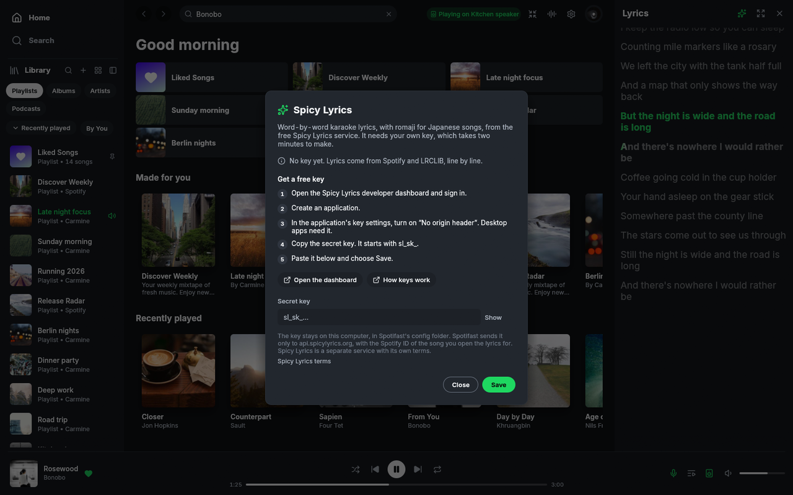
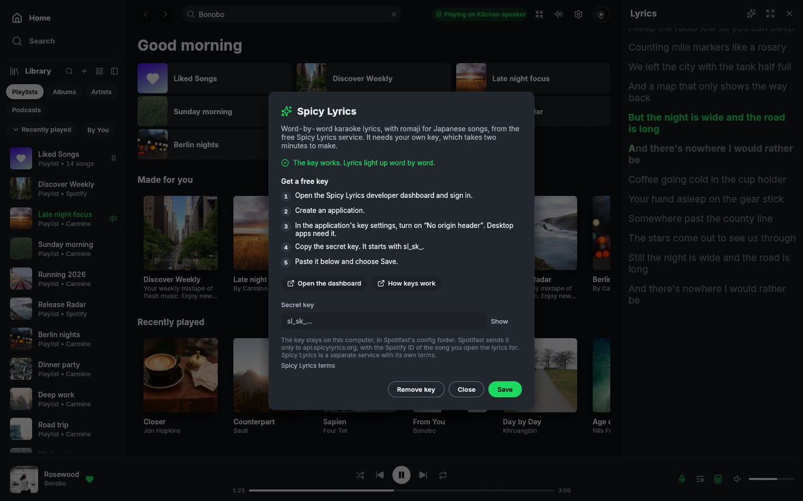
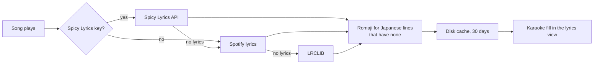

<h1 align="center">Spotifast Spicy Lyrics</h1>

<p align="center">
  <strong>Word-by-word karaoke lyrics in a native Spotify client.</strong><br>
  A fork of <a href="https://github.com/crmne/spotifast">Spotifast</a> that adds lyrics in the style of
  <a href="https://spicylyrics.org">Spicy Lyrics</a>. No browser engine, no Spicetify, no patches to Spotify.
</p>

<p align="center">
  <a href="https://github.com/TheBestIT/spotifast-spicylyrics/releases/latest"></a>
  <a href="https://github.com/TheBestIT/spotifast-spicylyrics/actions/workflows/ci.yml"></a>
  <a href="LICENSE"></a>
  
  <a href="https://github.com/crmne/spotifast"></a>
</p>

<p align="center">
  
</p>

<p align="center">
  <a href="docs/spicy/demo.mp4">Watch the demo video (MP4, 22 seconds)</a> ·
  <a href="#install">Install</a> ·
  <a href="#set-up-spicy-lyrics">Set up Spicy Lyrics</a> ·
  <a href="#build-from-source">Build from source</a> ·
  <a href="#services-and-privacy">Services and privacy</a>
</p>

> [!NOTE]
> This is an **unofficial fork**. Spotifast is the work of
> [Carmine Paolino](https://github.com/crmne). This fork changes only the
> lyrics. It is not affiliated with Spotify, with the Spotifast project, or
> with the Spicy Lyrics project. For a problem that is not about lyrics,
> try the [original Spotifast](https://github.com/crmne/spotifast) first.

## What the fork adds

| Feature | What you get |
| --- | --- |
| **Karaoke fill** | The line that plays lights up from left to right, word by word, with a soft edge. Songs with syllable timing fill syllable by syllable. |
| **Spicy Lyrics source** | Lyrics come from the [Spicy Lyrics API](https://developers.spicylyrics.org) first, with your own free key. Spotify and LRCLIB lyrics stay as the fallback. |
| **Fill for every synced song** | Songs that have only line timing also fill word by word. The app divides the line time between the words. |
| **Romaji** | Japanese lyrics can show in Latin letters. The romaji comes from Spicy Lyrics, or from a built-in dictionary when the service has none. |
| **Setup menu** | A Spicy Lyrics menu in the style of the app, with the steps, the links and a key check. Open it from the lyrics header or from Settings. |
| **Same views** | The side panel, the full screen view and the cinema view all show the fill. Smooth scroll and click-to-seek stay. |

Everything else is Spotifast: a fast, native Spotify client in Rust, with
Spotify Connect, a Winamp mini player, MilkDrop visuals, and 100 to 250 MB
of memory. Read the [Spotifast guide](https://spotifast.rocks) for these parts.

## Screenshots

<table>
  <tr>
    <td width="50%"><br><sub>Full screen view, the active line half sung</sub></td>
    <td width="50%"><br><sub>Japanese lyrics in romaji</sub></td>
  </tr>
  <tr>
    <td width="50%"><br><sub>The Spicy Lyrics setup menu</sub></td>
    <td width="50%"><br><sub>Lyrics side panel</sub></td>
  </tr>
</table>

The screenshots and the video show the app's demo mode. The song, the
playlists and the lyrics are sample data.

## Install

Download the file for your system from the
**[latest release](https://github.com/TheBestIT/spotifast-spicylyrics/releases/latest)**.

### Windows 10 and 11

| File | Use it when |
| --- | --- |
| `…-x86_64-pc-windows-msvc-setup.exe` | **Recommended.** A normal installer for your user account. No administrator rights. |
| `…-windows-amd64.msi` | You manage software with Windows Installer packages. |
| `…-x86_64-pc-windows-msvc.zip` | You want a portable copy. Unzip it and open `spotifast.exe`. |
| `…-aarch64-…` / `…-arm64…` | Your computer has an ARM processor. |

Windows can show a SmartScreen warning, because the files have no paid code
signature. Click **More info**, then **Run anyway**.

### Linux

| File | Use it when |
| --- | --- |
| `….AppImage` | Any distribution. Make it executable (`chmod +x`), then open it. |
| `…amd64.deb` | Debian 13, Ubuntu 24.04 and newer: `sudo apt install ./<file>.deb` |
| `…x86_64.rpm` | Fedora and openSUSE: `sudo dnf install ./<file>.rpm` |
| `….flatpak` | Flatpak: `flatpak install --user ./<file>.flatpak` |
| `…-unknown-linux-gnu.tar.gz` | A plain archive with the program and the desktop files. |

ARM computers use the `aarch64` or `arm64` files.

### Important to know

- **This fork replaces Spotifast.** It uses the same name, the same settings
  and the same sign-in. Install one or the other, not both. To go back,
  install the original Spotifast over it.
- **Updates come from this repository.** The app checks the releases of this
  fork, and accepts only files signed with the key of this fork. An update of
  the original Spotifast cannot replace the fork by accident.
- **Playback needs Spotify Premium**, as in Spotifast.

## Set up Spicy Lyrics

The word-by-word lyrics need a free key from Spicy Lyrics. The key takes two
minutes to make. The app shows you each step:

1. Open the lyrics. Click the **sparkles** button in the lyrics header. You
   can also open **Settings → Spicy Lyrics → Set up**.
2. Click **Open the dashboard** and sign in to the
   [Spicy Lyrics developer dashboard](https://developers.spicylyrics.org/dashboard/applications).
3. Create an application.
4. In the key settings of the application, turn on **No origin header**.
   Desktop apps need it.
5. Copy the **secret key**. It starts with `sl_sk_`.
6. Paste the key in the app and click **Save**. The app checks the key at
   once and shows the result.

<p align="center">
  
</p>

Without a key, the app still shows lyrics from Spotify and LRCLIB, and the
line still fills word by word. With a key, more songs get syllable timing
and romaji.

**Other ways to give the key:** put it in a text file named
`spicy_lyrics_key.txt` in the Spotifast config folder, or set the environment
variable `SPICY_LYRICS_KEY`. The environment variable wins over the file.

| System | Config folder |
| --- | --- |
| Windows | `%APPDATA%\paolino\spotifast\config\` |
| Linux | `~/.config/spotifast/` |

## Romaji for Japanese songs

When a song has Japanese lyrics, a **Romaji** button shows in the lyrics
header. Click it to show the lyrics in Latin letters. The app keeps your
choice for the next songs. **Settings → Spicy Lyrics → Romaji for Japanese
lyrics** does the same.

The romaji has two sources:

1. **Spicy Lyrics**, when it has a romanization for the song.
2. **A built-in dictionary**, when it has none, and for Spotify and LRCLIB
   lyrics. The app reads each word with the
   [IPADIC](https://github.com/lindera/lindera) dictionary and writes the
   reading in Hepburn romaji. Particles show as they sound (`は` → `wa`), and
   a small `っ` doubles the next consonant (`言った` → `itta`).

The dictionary gives the usual reading of a word. A song can use a rare
reading, so a few words can differ from the singer.

## Build from source

The scripts below install what is missing, build a release program, and can
install it for your user.

### Windows

1. Install Git, then get the code:
   ```powershell
   git clone https://github.com/TheBestIT/spotifast-spicylyrics.git
   cd spotifast-spicylyrics
   ```
2. Run the build script:
   ```powershell
   powershell -ExecutionPolicy Bypass -File scripts\build-windows.ps1 -InstallRust -Install
   ```

The script needs one C toolchain. If it finds none, it shows the command that
installs one:

- **Visual Studio Build Tools** (recommended):
  `winget install Microsoft.VisualStudio.2022.BuildTools --override "--quiet --wait --add Microsoft.VisualStudio.Workload.VCTools --includeRecommended"`
- **MinGW-w64** (smaller): `winget install BrechtSanders.WinLibs.POSIX.UCRT`

### Linux

```sh
git clone https://github.com/TheBestIT/spotifast-spicylyrics.git
cd spotifast-spicylyrics
scripts/build-linux.sh --deps --install
```

- `--deps` installs the build packages with `sudo` (apt, dnf, pacman or
  zypper).
- `--install` puts the program in `~/.local/bin` and adds it to your
  applications menu. It does not need `sudo`.

The script installs Rust with [rustup](https://rustup.rs) when it is missing.

### Options and manual build

- By default the scripts leave out the **MilkDrop** visualiser, because it
  needs CMake, LLVM (libclang) and, on Windows, GLEW. Add `-WithMilkDrop`
  (Windows) or `--milkdrop` (Linux) to include it. The release files include
  MilkDrop, but not the Windows on ARM files.
- A manual build is one command: `cargo build --release --no-default-features`.
  The program is then in `target/release/`.
- The first build takes 5 to 15 minutes. Later builds are faster.

## How it works



- **Sources.** The app asks Spicy Lyrics first, then Spotify, then LRCLIB. A
  failure of one source does not stop the next.
- **Timing.** Spicy Lyrics gives a start and an end for each syllable. For a
  song with line timing only, the app divides the line time between the words
  by their length.
- **Drawing.** The active line is one block of text, so it keeps the same wrap
  as the other lines. The app draws it again in the bright colour, clipped at
  the sung position, with a soft edge of six thin steps.
- **Speed.** All network and dictionary work runs in the background. The view
  repaints at the display rate only while a word fills.

The code for these parts is in `src/lyrics.rs` (model and parsers),
`src/backend.rs` (sources and key check), `src/romaji.rs` (romanization),
`src/ui/lyrics.rs` (drawing) and `src/ui/dialogs.rs` (setup menu).

## Services and privacy

This fork talks to the same services as Spotifast, plus Spicy Lyrics. It has
no telemetry and no server of its own.

| Service | When | What the app sends |
| --- | --- | --- |
| **Spotify** | All the time, as in Spotifast | Your Spotify session, through [librespot](https://github.com/librespot-org/librespot). Spotify lyrics come from the same session. |
| **Spicy Lyrics** (`api.spicylyrics.org`) | Only with a key, when you open the lyrics of a song, and once to check the key | Your key and the Spotify ID of the song. |
| **LRCLIB** (`lrclib.net`) | When Spicy Lyrics and Spotify have no lyrics | The artist, the title, the album and the length of the song. |
| **GitHub** | When the app checks for updates | A request for the releases of this repository. |

- **Your key stays on your computer**, in the config folder. When the app saves
  the key on Linux, only your user can read the file. The app sends the key only to
  `api.spicylyrics.org`.
- **Lyrics are cached** on your computer for 30 days, so a song asks each
  service once.
- **Remove the key** at any time: **Settings → Spicy Lyrics → Change key →
  Remove key**.
- Spicy Lyrics is a separate service with its own
  [terms](https://developers.spicylyrics.org/terms). Read them before you
  make a key. The key is yours, and so is its rate limit.
- About the risk to your Spotify account, read
  [the Spotifast answer](https://spotifast.rocks/what-is-spotifast/#will-my-spotify-account-get-banned).
  It applies to this fork too.

## The fork and the original

- **Base.** The fork starts from Spotifast
  [v0.14.0](https://github.com/crmne/spotifast/releases/tag/v0.14.0). The
  history of the original stays in this repository.
- **Versions.** A fork version is the Spotifast version plus a suffix:
  `0.14.0-spicy.1` is the first fork release on Spotifast 0.14.0.
- **What changes.** The lyrics features above, the setup menu, the update
  source, the release workflows, and the package metadata (publisher and
  links). Everything else is the same as the original.
- **Original documentation.** The README of Spotifast is in
  [docs/UPSTREAM-README.md](docs/UPSTREAM-README.md). Its guide at
  [spotifast.rocks](https://spotifast.rocks) applies to this fork too.
- **Support the original author.** If you like the app, think about a
  donation to [Carmine Paolino](https://github.com/sponsors/crmne), who wrote
  Spotifast.

## Report a problem

- **Lyrics, romaji or the Spicy Lyrics menu:** open an issue in
  [this repository](https://github.com/TheBestIT/spotifast-spicylyrics/issues).
- **Anything else:** check if the original Spotifast has the same problem.
  If it does, report it [there](https://github.com/crmne/spotifast/issues).

Add the log of the last run. It is in the data folder:
`%LOCALAPPDATA%\paolino\spotifast\data\spotifast.log` on Windows and
`~/.local/state/spotifast/spotifast.log` on Linux.

## Credits

- **[Spotifast](https://github.com/crmne/spotifast)** by Carmine Paolino, the
  app this fork builds on. MIT License.
- **[Spicy Lyrics](https://spicylyrics.org)** by Spikerko and contributors,
  the lyrics service and the Spicetify extension that inspired the look of
  this fork. This fork contains no code from the extension.
- **[LRCLIB](https://lrclib.net)**, the free lyrics database.
- **[lindera](https://github.com/lindera/lindera)** with the mecab-ipadic
  dictionary, and **[wana_kana](https://github.com/PSeitz/wana_kana_rust)**,
  for romaji.
- **[librespot](https://github.com/librespot-org/librespot)** and
  **[egui](https://www.egui.rs)**, through Spotifast.

## License

The fork keeps the [MIT License](LICENSE) of Spotifast. The copyright of the
original code stays with Carmine Paolino. The copyright of the fork changes
is with TheBestIT.

Spotify is a trademark of Spotify AB. This project is not affiliated with
Spotify AB, with the Spotifast project or with the Spicy Lyrics project. Lyrics
belong to their rights holders.

<details>
<summary><strong>Third-party notices</strong></summary>

The program contains data from mecab-ipadic-2.7.0-20070801 through
lindera-ipadic. Its licence asks for this notice with every copy. The full
list of notices is in [THIRD-PARTY-NOTICES.md](THIRD-PARTY-NOTICES.md).

```
mecab-ipadic-2.7.0-20070801 Notice

Nara Institute of Science and Technology (NAIST), the copyright holders,
disclaims all warranties with regard to this software, including all implied
warranties of merchantability and fitness, in no event shall NAIST be liable
for any special, indirect or consequential damages or any damages whatsoever
resulting from loss of use, data or profits, whether in an action of
contract, negligence or other tortuous action, arising out of or in
connection with the use or performance of this software.

A large portion of the dictionary entries originate from ICOT Free Software.
The following conditions for ICOT Free Software applies to the current
dictionary as well.

Each User may also freely distribute the Program, whether in its original
form or modified, to any third party or parties, PROVIDED that the provisions
of Section 3 ("NO WARRANTY") will ALWAYS appear on, or be attached to, the
Program, which is distributed substantially in the same form as set out
herein and that such intended distribution, if actually made, will neither
violate or otherwise contravene any of the laws and regulations of the
countries having jurisdiction over the User or the intended distribution
itself.

NO WARRANTY

The program was produced on an experimental basis in the course of the
research and development conducted during the project and is provided to
users as so produced on an experimental basis. Accordingly, the program is
provided without any warranty whatsoever, whether express, implied,
statutory or otherwise. The term "warranty" used herein includes, but is not
limited to, any warranty of the quality, performance, merchantability and
fitness for a particular purpose of the program and the nonexistence of any
infringement or violation of any right of any third party.

Each user of the program will agree and understand, and be deemed to have
agreed and understood, that there is no warranty whatsoever for the program
and, accordingly, the entire risk arising from or otherwise connected with
the program is assumed by the user.

Therefore, neither ICOT, the copyright holder, or any other organization
that participated in or was otherwise related to the development of the
program and their respective officials, directors, officers and other
employees shall be held liable for any and all damages, including, without
limitation, general, special, incidental and consequential damages, arising
out of or otherwise in connection with the use or inability to use the
program or any product, material or result produced or otherwise obtained
by using the program, regardless of whether they have been advised of, or
otherwise had knowledge of, the possibility of such damages at any time
during the project or thereafter. Each user will be deemed to have agreed to
the foregoing by his or her commencement of use of the program. The term
"use" as used herein includes, but is not limited to, the use, modification,
copying and distribution of the program and the production of secondary
products from the program.

In the case where the program, whether in its original form or modified,
was distributed or delivered to or received by a user from any person,
organization or entity other than ICOT, unless it makes or grants
independently of ICOT any specific warranty to the user in writing, such
person, organization or entity, will also be exempted from and not be held
liable to the user for any such damages as noted above as far as the program
is concerned.
```

</details>
